<!-- Banner -->

  

<!-- Typing tagline -->

  

<!-- Contact badges -->

  
  
  

## ⟡ Tech stack

 <table> <tr> <td align="center" width="88"> <b>Python</b></td> <td align="center" width="88"> <b>Java</b></td> <td align="center" width="88"> <b>C++</b></td> <td align="center" width="88"> <b>C#</b></td> <td align="center" width="88"> <b>JavaScript</b></td> <td align="center" width="88"> <b>HTML</b></td> <td align="center" width="88"> <b>CSS</b></td> <td align="center" width="88"> <b>MATLAB</b></td> </tr> </table> <table> <tr> <td align="center" width="88"> <b>.NET</b></td> <td align="center" width="88"> <b>Spring Boot</b></td> <td align="center" width="88"> <b>Django</b></td> <td align="center" width="88"> <b>Node.js</b></td> <td align="center" width="88"> <b>React</b></td> <td align="center" width="88"> <b>Express</b></td> </tr> </table> <table> <tr> <td align="center" width="88"> <b>PostgreSQL</b></td> <td align="center" width="88"> <b>MongoDB</b></td> <td align="center" width="88"> <b>Kafka</b></td> <td align="center" width="88"> <b>Azure</b></td> <td align="center" width="88"> <b>Google Cloud</b></td> <td align="center" width="88"> <b>AWS</b></td> </tr> </table> <table> <tr> <td align="center" width="88"> <b>Docker</b></td> <td align="center" width="88"> <b>GitHub Actions</b></td> <td align="center" width="88"> <b>Git</b></td> <td align="center" width="88"> <b>GitHub</b></td> <td align="center" width="88"> <b>Netlify</b></td> <td align="center" width="88"> <b>VS Code</b></td> <td align="center" width="88"> <b>Visual Studio</b></td> </tr> </table> 

        
 
 <b>Data &amp; BI</b>          
 
 <b>Cloud &amp; streaming</b>       
 
 <b>Architecture &amp; backend</b>          
 
 <b>AI, security &amp; ways of working</b>        

## ⟡ GitHub stats

  
  

  

  

